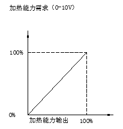
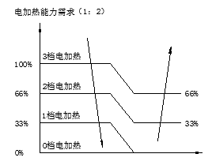
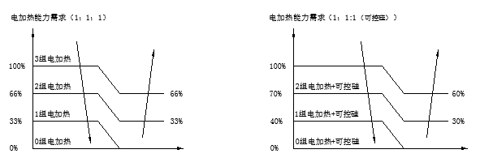
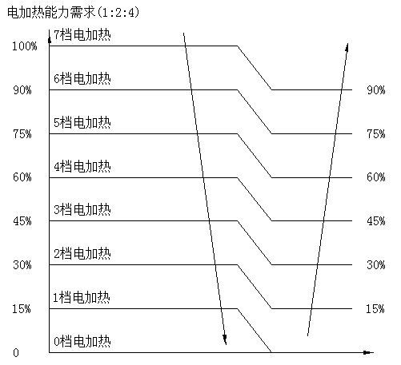

# 能力输出图

用户2026-11-04补充了输出图。以下PNG从仓库《采用电子膨胀阀定频直膨机控制规格书260124.doc》的内嵌PNG提取并做过视觉核对，内容与所示图相符；它们不是用户截图原始字节。原始Word和PNG的SHA-256、提取偏移见provenance.json。仅保存内机图，不导入后续外机流程图。

0～10V能力输出：0→100%需求对应0→100%输出。

1:2输出：0/33/66/100%分档，带加载与卸载滞回。图的横轴没有完整数字阈值，不能据此证明17/50/83%等具体切换点。

右侧为本项目采用的可控硅组合：1路SCR余量AO+2组DO，确认容量40/30/30，加载标注40/70%，卸载标注30/60%。左侧普通1:1:1图保留用于识别来源，不擅自增加当前枚举。等号动作方向需保留测试点：39.9/40/40.1，69.9/70/70.1，29.9/30/30.1，59.9/60/60.1%。

1:2:4输出：标注0/15/30/45/60/75/90/100%及加载/卸载阶梯；DO位权1/2/4。不要擅自将图的标注替换成精确1/7分数，也不要将图中没有标明的横轴阈值当成已验收。

测试要求：主热、共用再热、独立再热、预热分别升降扫，记录需求、档位、各DO、AO及实际端子；SCR需核对扣除DO后的余量，而非只看某一路AO大小。图的原始离散能力标注、物理电热组选型、代码切换阈值分栏列出。
